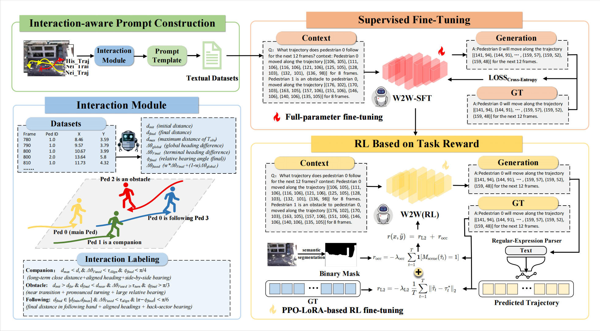

<div align="center">

# W2W: Language-Model-Based Trajectory Prediction<br>with Reinforcement Learning

### CVPR 2026

**Zirui Xu<sup>1</sup>, Biao Yang<sup>1,✉</sup>, Rongrong Ni<sup>1</sup>, Zhongkai Zhou<sup>2</sup>, Shaobo Shen<sup>1</sup>**

<sup>1</sup>Changzhou University, China &nbsp;&nbsp; <sup>2</sup>Jiangsu University of Technology, China<br>
<sup>✉</sup>Corresponding author

[](https://openaccess.thecvf.com/content/CVPR2026/html/Xu_W2W_Language-Model-Based_Trajectory_Prediction_with_Reinforcement_Learning_CVPR_2026_paper.html)
[](https://openaccess.thecvf.com/content/CVPR2026/papers/Xu_W2W_Language-Model-Based_Trajectory_Prediction_with_Reinforcement_Learning_CVPR_2026_paper.pdf)
[](https://github.com/VoyagerXu21/W2W)

**Write-to-Walk: learning how to answer, then learning how to walk.**

</div>

Official implementation of **W2W**, a language-model-based framework for pedestrian trajectory prediction with reinforcement learning.

W2W expresses motion history and social interaction cues as text, learns to generate parseable trajectories through supervised fine-tuning, and aligns predictions with geometric accuracy and scene constraints through PPO.

<p align="center">
  
</p>

<p align="center"><em>W2W combines interaction-aware trajectory prompts with supervised language learning and reward-based policy optimization.</em></p>

## Contents

- [Overview](#overview)
- [Installation](#installation)
- [Data Preparation](#data-preparation)
- [Training](#training)
- [Evaluation](#evaluation)
- [Repository Structure](#repository-structure)
- [Citation](#citation)
- [Acknowledgements](#acknowledgements)

## Overview

W2W uses a **T5-Small** backbone and a two-stage training procedure:

1. **Supervised fine-tuning (SFT).** Train the full model with cross-entropy to generate structured trajectory answers from textual observations and interaction cues.
2. **Reinforcement learning (PPO).** Starting from the SFT model, optimize LoRA adapters using a programmatic reward that combines trajectory error with penalties for entering non-walkable regions.

The framework provides:

- **Interaction-aware prompts** that represent motion history and social relationships in language.
- **Task-specific rewards** that connect generated text to trajectory accuracy and scene compliance.
- **Meter- and pixel-coordinate configurations**, with stochastic sampling and deterministic decoding options.

The [paper](https://openaccess.thecvf.com/content/CVPR2026/papers/Xu_W2W_Language-Model-Based_Trajectory_Prediction_with_Reinforcement_Learning_CVPR_2026_paper.pdf) reports experiments on **ETH/UCY** and the **Stanford Drone Dataset (SDD)**. The commands and configurations in this repository currently expose the five ETH/UCY splits: `eth`, `hotel`, `univ`, `zara1`, and `zara2`.

**Release contents.** This repository includes source code, experiment configurations, and the pipeline figure. Dataset files, scene assets, trained tokenizers, pretrained W2W checkpoints, and a pinned environment are not included.

## Installation

Use **Python 3.10 or later**. A CUDA-capable GPU is required by the supplied PPO configuration. The shell examples below assume Bash and run from the repository root.

```bash
git clone https://github.com/VoyagerXu21/W2W.git
cd W2W

python -m venv .venv
source .venv/bin/activate
python -m pip install --upgrade pip
```

Install a PyTorch build appropriate for your CUDA environment, then install the packages used by the training, evaluation, and preprocessing code:

```bash
python -m pip install torch
python -m pip install transformers accelerate datasets evaluate trl peft \
  sentencepiece protobuf numpy scipy pandas scikit-learn \
  pillow opencv-python nltk rouge-score absl-py filelock tqdm matplotlib

python -m nltk.downloader punkt punkt_tab
accelerate config
```

These commands list the runtime dependencies; they are not a version-locked reproduction environment. The custom PPO trainer uses internal TRL and Transformers APIs, so their versions must be compatible with the imports in [utils/ppo_trainer.py](utils/ppo_trainer.py).

## Data Preparation

### 1. Arrange trajectories and scene assets

Prepare the ETH/UCY data and the corresponding scene files under `datasets/`. The default observation and prediction horizons are **8** and **12** steps, respectively.

```text
datasets/
├── eth/
│   ├── train/
│   ├── val/
│   └── test/
├── hotel/                    # Same train/val/test layout
├── univ/
├── zara1/
├── zara2/
├── homography/               # <scene_name>_H.txt
├── image/                    # Reference images, oracle maps, and captions
├── masks/                    # Binary scene masks for PPO rewards
└── preprocessed/             # Trajectory-language JSONL files
```

Raw trajectory files contain tab-separated rows in the form `frame_id  pedestrian_id  x  y`. The loader resolves homographies as `homography/<scene_name>_H.txt` and scene images as `image/<image_id>_reference.png` and `image/<image_id>_oracle.png`; optional descriptions use `image/<image_id>_caption.txt`. See [utils/dataloader.py](utils/dataloader.py) for the scene-to-image mapping.

PPO also loads `eth_mask.png`, `hotel_mask.png`, `univ_mask.png`, `zara1_mask.png`, and `zara2_mask.png` from `datasets/masks/`. Its reward model treats grayscale values below `128` as non-walkable. Match the masks to the coordinate convention used for training; the PPO mask paths are defined in [model/trainval_accelerator.py](model/trainval_accelerator.py).

### 2. Prepare trajectory-language pairs

The preprocessing implementation is [utils/preprocessor.py](utils/preprocessor.py), with a batch launcher at [script/preprocessor.sh](script/preprocessor.sh). It creates JSONL records containing the `observation` and `forecast` text fields, trajectory coordinates, and scene metadata.

> **Preprocessing compatibility:** the current preprocessing entry point mixes script-style imports with package-relative imports. Align those imports with your Python package layout before using the launcher if it raises an import error.

Training and evaluation expect the following filename patterns for each dataset and coordinate system:

| Purpose | File under `datasets/preprocessed/` |
| --- | --- |
| Training | `<dataset>-train-8-12-<metric>-multimodal.json` |
| Validation | `<dataset>-val-8-12-<metric>.json` |
| Testing | `<dataset>-test-8-12-<metric>.json` |

Here, `<metric>` is `meter` or `pixel`. Despite the `.json` extension, these files contain one JSON record per line. Use consistent data splits, scene assets, and coordinate conventions across preprocessing, training, and evaluation.

### 3. Prepare the tokenizer

Once the preprocessed training data is available, train a trajectory tokenizer for the coordinate system you will use. For example:

```bash
python utils/tokenizer.py --dataset eth --model bpe --metric meter
python utils/tokenizer.py --dataset eth --model bpe --metric pixel
```

The tokenizer directories match the defaults in the base configurations:

```text
checkpoint/tokenizer/trajectoryspiece-meter-bpe/
checkpoint/tokenizer/trajectoryspiece-pixel-bpe/
```

Tokenizer output paths are shared across dataset names. Preserve the tokenizer used for each experiment and use the same tokenizer throughout SFT, PPO, and evaluation.

## Training

### Configuration

Configurations inherit shared defaults through `_base_`. Use the dedicated SFT and PPO files for new experiments.

| Configuration | Purpose |
| --- | --- |
| [config/sft-meter.json](config/sft-meter.json) | SFT with meter coordinates |
| [config/sft-pixel.json](config/sft-pixel.json) | SFT with pixel coordinates |
| [config/sft-meter-deterministic.json](config/sft-meter-deterministic.json) | Meter configuration with deterministic evaluation |
| [config/sft-pixel-deterministic.json](config/sft-pixel-deterministic.json) | Pixel configuration with deterministic evaluation |
| [config/ppo-pixel.json](config/ppo-pixel.json) | PPO initialized from a pixel-coordinate SFT checkpoint |

The unified entry point is:

```bash
accelerate launch trainval.py \
  --cfg <config-path> \
  --dataset <dataset-name> \
  --tag <experiment-name> \
  --train_mode <sft|ppo>
```

`--train_mode` overrides the configuration's `train_mode`. `--tag` selects the experiment directory under `checkpoint_path` (by default, `./checkpoint/`).

### Stage 1: Supervised fine-tuning

Train a pixel-coordinate model to initialize the supplied PPO configuration:

```bash
accelerate launch trainval.py \
  --cfg ./config/sft-pixel.json \
  --dataset eth \
  --tag W2W-sft-pixel-eth \
  --train_mode sft
```

For a meter-coordinate SFT experiment:

```bash
accelerate launch trainval.py \
  --cfg ./config/sft-meter.json \
  --dataset eth \
  --tag W2W-sft-meter-eth \
  --train_mode sft
```

The final model and tokenizer are saved to `checkpoint/<experiment-name>/`. Update `dataset_path`, `tokenizer_name`, `model_name_or_path`, and batch sizes in the configuration as needed for your environment.

### Stage 2: PPO fine-tuning

Before launching PPO, update [config/ppo-pixel.json](config/ppo-pixel.json) to point to your **pixel-coordinate SFT model**. For the example above, the relevant entries are:

```json
{
  "model_name_or_path": "./checkpoint/W2W-sft-pixel-eth/",
  "ce_checkpoint_dir": "./checkpoint/W2W-sft-pixel-eth/",
  "tokenizer_name": "./checkpoint/W2W-sft-pixel-eth/",
  "rl_checkpoint_dir": "./checkpoint/W2W-ppo-pixel-eth/",
  "ppo": {
    "value_model": {
      "policy_model_name": "./checkpoint/W2W-sft-pixel-eth/"
    },
    "trainer": {
      "output_dir": "./checkpoint/W2W-ppo-pixel-eth/"
    }
  }
}
```

Apply these entries to the existing configuration while retaining its other settings. Reward weights, LoRA parameters, generation settings, and PPO hyperparameters are grouped under `ppo`. Adjust the training and PPO batch settings together to fit your GPU memory.

```bash
accelerate launch trainval.py \
  --cfg ./config/ppo-pixel.json \
  --dataset eth \
  --tag W2W-ppo-pixel-eth \
  --train_mode ppo
```

The final policy is saved to `checkpoint/W2W-ppo-pixel-eth/` with the default `checkpoint_path`.

## Evaluation

Use `--test` with the tag of an existing checkpoint and a configuration whose coordinate system matches that checkpoint. Evaluation loads both the model and tokenizer from `checkpoint_path/<tag>/`.

Evaluate the pixel-coordinate SFT checkpoint:

```bash
accelerate launch trainval.py \
  --cfg ./config/sft-pixel.json \
  --dataset eth \
  --tag W2W-sft-pixel-eth \
  --test
```

Evaluate the PPO checkpoint:

```bash
accelerate launch trainval.py \
  --cfg ./config/ppo-pixel.json \
  --dataset eth \
  --tag W2W-ppo-pixel-eth \
  --test
```

For deterministic decoding, evaluate a matching checkpoint with `sft-pixel-deterministic.json` or `sft-meter-deterministic.json`. For stochastic evaluation, control `num_samples`, `best_of_n`, `temperature`, and `top_k` in the configuration. The default stochastic configuration generates `1000` candidates and uses `best_of_n=20` during postprocessing.

The evaluator reports **ADE** (average displacement error) and **FDE** (final displacement error), taking the minimum for each metric across the postprocessed candidate trajectories. Pixel-coordinate predictions are converted back to world coordinates before scoring on ETH/UCY. Lower values indicate better performance. Refer to the [paper](https://openaccess.thecvf.com/content/CVPR2026/papers/Xu_W2W_Language-Model-Based_Trajectory_Prediction_with_Reinforcement_Learning_CVPR_2026_paper.pdf) for benchmark results and evaluation protocols.

Batch examples are available in [script/trainval_all.sh](script/trainval_all.sh), [script/eval_all.sh](script/eval_all.sh), and [script/eval_all_deterministic.sh](script/eval_all_deterministic.sh). Replace their experiment tags with your own checkpoint names before use.

## Repository Structure

```text
W2W/
├── assets/
│   └── pipeline.png                  # Method overview
├── config/                           # Base, SFT, PPO, and evaluation settings
├── model/
│   ├── trainval_accelerator_SFT.py    # Supervised fine-tuning
│   ├── trainval_accelerator.py        # PPO training and reward model
│   └── eval_accelerator.py            # Trajectory generation and evaluation
├── script/                           # Batch preprocessing, training, and evaluation
├── utils/
│   ├── preprocessor.py               # Trajectory-to-text preprocessing
│   ├── tokenizer.py                  # Trajectory tokenizer training
│   ├── ppo_trainer.py                # Custom PPO trainer
│   └── postprocessor.py              # Candidate trajectory postprocessing
├── trainval.py                       # Unified SFT/PPO training and evaluation entry point
├── trainrl.py                        # Additional RL training entry point
├── conv.py                           # Checkpoint conversion utility
└── README.md
```

## Citation

If you find this work useful in your research, please cite our paper:

```bibtex
@InProceedings{Xu_2026_CVPR,
  author    = {Xu, Zirui and Yang, Biao and Ni, Rongrong and Zhou, Zhongkai and Shen, Shaobo},
  title     = {W2W: Language-Model-Based Trajectory Prediction with Reinforcement Learning},
  booktitle = {Proceedings of the IEEE/CVF Conference on Computer Vision and Pattern Recognition (CVPR)},
  month     = {June},
  year      = {2026},
  pages     = {23538-23548}
}
```

## Acknowledgements

We thank the maintainers of [Hugging Face Transformers](https://github.com/huggingface/transformers), [Accelerate](https://github.com/huggingface/accelerate), [TRL](https://github.com/huggingface/trl), [PEFT](https://github.com/huggingface/peft), and [SentencePiece](https://github.com/google/sentencepiece) for their open-source tools.
